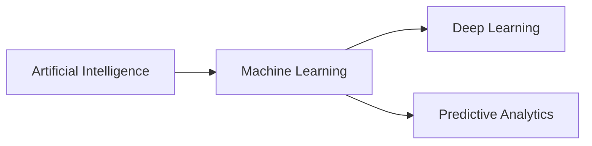

# Machine Learning (ML)

This is a library of deep learning and predictive analytics written from scratch in Elixir.



## Installation

Given this is project was created for educational purposes it's not on available in [Hex](https://hex.pm).

To install clone this repo and run `mix test`.

## FizzBuzz classifier

`ML.Classifiers.FizzBuzz.classify/1` trains a four-class, single-layer neural
network with stochastic gradient descent, then predicts an integer's label.
It accepts positive and negative integers, including zero, and returns one of
`"None"`, `"Fizz"`, `"Buzz"`, or `"FizzBuzz"`.

```elixir
ML.Classifiers.FizzBuzz.classify(7)   #=> "None"
ML.Classifiers.FizzBuzz.classify(9)   #=> "Fizz"
ML.Classifiers.FizzBuzz.classify(10)  #=> "Buzz"
ML.Classifiers.FizzBuzz.classify(15)  #=> "FizzBuzz"
```

The three inputs are a bias and two divisibility flags. Training uses the
representative numbers 1, 3, 5, and 15. Each call starts from zero weights and
updates them over 500 passes through those examples. This keeps the example
deterministic and makes training observable through `train/0`; it also means
every classification pays the cost of training.

## Guides

TODO: Add links to the livebook notebooks.
