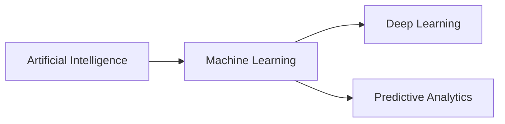

# Machine Learning (ML)

This is a library of deep learning and predictive analytics written from scratch in Elixir.



## Installation

This educational project is not published on [Hex](https://hex.pm).

Clone the repository and run `mix test` from its root.

## FizzBuzz classifier

`ML.Classifiers.FizzBuzz.classify/1` trains a four-class, single-layer neural
network with stochastic gradient descent, then predicts an integer's label.
It accepts positive and negative integers, including zero, and returns one of
`"None"`, `"Fizz"`, `"Buzz"`, or `"FizzBuzz"`.

```elixir
ML.Classifiers.FizzBuzz.classify(7)   #=> "None"
ML.Classifiers.FizzBuzz.classify(9)   #=> "Fizz"
ML.Classifiers.FizzBuzz.classify(10)  #=> "Buzz"
ML.Classifiers.FizzBuzz.classify(15)  #=> "FizzBuzz"
```

The three inputs are a bias and two divisibility flags. Training uses the
representative numbers 1, 3, 5, and 15. Each call starts from zero weights and
updates them over 500 passes through those examples. This keeps the example
deterministic and makes training observable through `train/0`; it also means
every classification pays the cost of training.

For each example, the training step computes four scores with dot products,
applies softmax to get probabilities, and subtracts a learning-rate-scaled
gradient from each weight. The gradient for a weight is
`(predicted_probability - one_hot_target) * input_feature`.
`ML.Classifiers.FizzBuzz.loss/2` returns the cross-entropy loss for a
probability vector and correct class index. Training uses its gradient directly
without calculating the scalar loss.

```elixir
weights = ML.Classifiers.FizzBuzz.train()
probabilities = ML.Classifiers.FizzBuzz.predict_probabilities(3, weights)
ML.Classifiers.FizzBuzz.loss(probabilities, 1) # 1 is the "Fizz" class index
```

The probability order is `"None"`, `"Fizz"`, `"Buzz"`, `"FizzBuzz"` (indices
0 through 3). A lower loss means more probability was assigned to the correct
class. `ML.fizz_buzz/1` is a shortcut for `classify/1`.

## Guides

See the [Livebook guides](notebooks/livebooks.md), starting with the
[FizzBuzz notebook](notebooks/classifiers/fizz_buzz.livemd).
